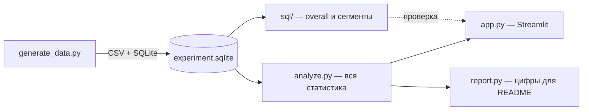

# Express Checkout — A/B

<p align="center">
  
  
  
  
  
</p>

<p align="center">
  <b>Product analytics case · эксперимент</b><br/>
  Катить «Купить сразу» на всех — или только там, где эффект есть<br/>
  <i>Дизайн A/B-теста, проверка валидности, эффект с доверительным интервалом и решение ship / iterate по сегментам.</i>
</p>

<p align="center">
  <b>Решение.</b> Overall CR <b>+12.1%</b> (p = 0.0002), но lift почти весь с <b>desktop (+25.5%)</b>.
  iOS и Android без значимого эффекта. AOV −3.2%, но <b>RPU +15 ₽</b> (p = 0.014) — катим desktop, mobile дорабатываем.
</p>

---

## О проекте

**Express Checkout** — второй кейс портфолио для стажировки **product analyst**: A/B-тест кнопки «Купить сразу» на карточке товара против обычного пути «в корзину → чекаут».

Продуктовый вопрос — не «вырос ли CR в среднем», а стоит ли катить фичу всем, если эффект неравномерный по устройствам. Единица рандомизации — пользователь (ITT), 50/50, 14 дней, 42 000 человек. Primary-метрика — conversion, guardrails — AOV и выручка на пользователя (RPU).

> **Данные синтетические.** Эффекты заложены в `generate_data.py` (lift на desktop, ~0 на mobile, меньший чек в treatment). Цель кейса — показать правильный порядок анализа и не попасться в типичные ловушки, а не «открыть» заложенное. Все цифры ниже печатает `python src/report.py`.

```text
┌───────────────────────────────────────────────────────────┐
│              === EXPRESS CHECKOUT A/B ===                 │
│                                                           │
│  SRM · мощность / MDE       CR control vs treatment + CI  │
│  Сегменты + поправка Холма  Разница эффектов (interaction)│
│  Guardrail: RPU по девайсам Динамика: подглядывание       │
│  Решение: ship / iterate                                  │
└───────────────────────────────────────────────────────────┘
```

---

## Стек

| Технология        | Зачем в проекте                                                    |
| ------------------ | --------------------------------------------------------------------- |
| **Python 3.10+**    | генератор назначений и слой статистики                              |
| **SQLite + SQL**    | conversion и RPU запросом — проверка, что цифры не «из головы»       |
| **scipy / statsmodels** | SRM (binomtest), z-test долей, Wilson CI, Welch t-test, поправка Холма, MDE и sample size |
| **Streamlit**       | дашборд эксперимента и карточка решения                              |
| **Plotly**          | бары с доверительными интервалами, сегменты, накопленный эффект      |

---

## Что нашёл

|     | Проверка                    | Результат                                                              |
| --- | ---------------------------- | -------------------------------------------------------------------------- |
| ✓   | **SRM**                       | 50.1% в treatment, p = 0.65 — сплит не сломан                             |
| ✓   | **Overall conversion**        | 8.57% → 9.61%, **+12.1%** отн., p = 0.0002, Δ +1.04 п.п. [+0.49 … +1.59]  |
| ✓   | **Desktop**                   | **+25.5%**, p_holm < 0.001 — эффект реальный                              |
| ✗   | **iOS / Android**              | −0.8% / −1.9%, не значимо. Большой прирост исключён: верх CI на iOS +0.8 п.п. |
| ✓   | **Desktop ≠ mobile**           | разница lift'ов +2.76 п.п. [+1.60 … +3.91], p < 0.001 — проверена сама разница, а не два p-value |
| ✗   | **Новые vs вернувшиеся**       | +1.03 vs +1.04 п.п., p = 0.98 — «новым помогает сильнее» **не подтверждается** |
| ✓   | **Guardrail: RPU**             | AOV −3.2%, но RPU **+15 ₽** [+3 … +28], p = 0.014; на desktop **+46 ₽** |
| ✓   | **Динамика**                   | эффект не затухает; в первую неделю p > 0.05 — ранняя остановка дала бы ложный «ноль» |

### Модель данных

```text
assignments
─────────────────────────────────────────
 user_id      уникальный пользователь теста
 variant      control | treatment
 device       desktop | ios | android
 user_type    new | returning
 channel      канал привлечения
 assigned_at  когда попал в тест
 purchased    0 / 1 — купил ли (в знаменателе все назначенные, ITT)
 revenue      сумма покупки, 0 если не купил
```

---

## Архитектура



| Файл               | Ответственность                                                          |
| -------------------- | ----------------------------------------------------------------------------- |
| `src/generate_data.py` | 42 000 назначений: variant, device, user_type, purchased, revenue (seed=24) |
| `src/analyze.py`      | SRM, z-test долей, Wilson CI, Welch t-test по RPU, Холм, interaction, динамика, MDE |
| `src/report.py`       | печатает все цифры из README — README обновляется только по нему           |
| `sql/`                | conversion и RPU по веткам и по device/user_type — проверка Python           |
| `app.py`              | порядок анализа на экране: SRM → primary → сегменты → guardrail → динамика → решение |

**Почему так?** Дашборд не считает статистику сам — только вызывает функции `analyze.py`, чтобы формулы жили в одном проверяемом месте. Порядок блоков на экране — это и есть правильный порядок анализа эксперимента, а не просто вёрстка.

---

## Структура

```text
express-checkout-ab-test
├── app.py
├── README.md
├── requirements.txt
├── src
│   ├── generate_data.py
│   ├── analyze.py
│   └── report.py
├── sql
│   ├── 01_overall.sql
│   └── 02_segments.sql
└── data              ← создаётся генератором, в git не хранится
    ├── assignments.csv
    └── experiment.sqlite
```

---

## Быстрый старт

### 1. Требования

- Python **3.10+**

### 2. Установка

```bash
python3 -m venv .venv && source .venv/bin/activate   # Windows: .venv\Scripts\activate
pip install -r requirements.txt
```

### 3. Данные и цифры

```bash
python src/generate_data.py
python src/report.py
```

> Генерацию можно пропустить — дашборд и `analyze.py` создадут данные сами, если `experiment.sqlite` ещё нет.

### 4. Дашборд

```bash
streamlit run app.py
```

---

## Пример вывода

```text
SRM p-value                    0.65    (сплит в порядке)

CR control                    8.57%
CR treatment                  9.61%    (+12.1% отн., p = 0.0002)
Δ CR абс.                    +1.04 п.п.  95% CI [+0.49 … +1.59]
MDE (80% power)               0.78 п.п.

                       lift     p      p_holm
Desktop               +25.5%   <0.001  <0.001  → ship
Android                −1.9%    0.77    1.00   → не значимо
iOS                    −0.8%    0.90    1.00   → не значимо
New                   +13.2%    0.010   0.032
Returning             +11.3%    0.008   0.032

Desktop vs mobile     Δ lift +2.76 п.п.   p < 0.001   → эффекты разные
New vs returning      Δ lift −0.02 п.п.   p = 0.98    → эффекты одинаковые

AOV                    −3.2%
RPU                    +15 ₽   [+3 … +28], p = 0.014
RPU desktop            +46 ₽   [+22 … +70], p < 0.001
```

---

## Ключевые решения в коде

<details>
<summary><b>Почему ITT (intent-to-treat), а не только купившие?</b></summary>

<br/>

В знаменателе — все назначенные в ветку, даже те, кто ничего не купил. Иначе сравнение смещается: 1-click может привлекать «случайных» кликнувших, которые в контроле вообще не дошли бы до чекаута.

```python
p_c = x_c / n_c  # n_c — все назначенные в control, не только купившие
```
</details>

<details>
<summary><b>Почему порог SRM 0.001, а не обычные 0.05?</b></summary>

<br/>

SRM — проверка исправности сплита, а не гипотеза о продукте. Её прогоняют на каждом эксперименте, и при пороге 0.05 каждый двадцатый исправный тест ложно браковался бы. Поэтому порог строже — 0.001, как принято в индустрии:

```python
pval = stats.binomtest(n_t, n, expected).pvalue
"pass": pval > 0.001
```
</details>

<details>
<summary><b>Почему Wilson CI, а не обычный доверительный интервал по нормали?</b></summary>

<br/>

Wilson-интервал корректнее нормального приближения для долей, особенно близких к 0 и на небольших сегментах. При N в десятки тысяч разница мала, но метод остаётся верным и для мелких срезов:

```python
ci_c = proportion_confint(x_c, n_c, alpha=ALPHA, method="wilson")
```
</details>

<details>
<summary><b>Зачем поправка Холма на сегментах?</b></summary>

<br/>

Срезов пять (3 девайса + 2 типа пользователей). При α = 0.05 на каждом шанс получить хотя бы одно ложное «значимо» ≈ 1 − 0.95⁵ ≈ 23%. Холм держит групповую ошибку на 5% и при этом мощнее Бонферрони:

```python
reject, p_adj, _, _ = multipletests(out["p_value"], alpha=ALPHA, method="holm")
```
</details>

<details>
<summary><b>Почему «в одном сегменте значимо, в другом нет» — не вывод?</b></summary>

<br/>

Первая версия кейса утверждала, что новым пользователям фича помогает сильнее (+13% против +11%). Проверка самой разницы показала: абсолютный прирост одинаковый (+1.03 и +1.04 п.п., p = 0.98). Сравнивать нужно эффекты между собой:

```python
diff = ra["abs_lift"] - rb["abs_lift"]
se = math.sqrt(_var(ra) + _var(rb))
```

Для desktop vs mobile та же проверка даёт p < 0.001 — там разница настоящая, и решение «катить только desktop» на ней и держится.
</details>

<details>
<summary><b>Почему смотрим RPU, а не только AOV?</b></summary>

<br/>

AOV считается только по купившим и не видит, что купило больше людей. RPU делится на всех назначенных — так виден настоящий эффект на выручку:

```python
aov_t = t[t > 0].mean()          # только купившие — может ввести в заблуждение
rpu_treatment = t.mean()          # все назначенные, включая нули — реальные деньги на человека
```

Отсюда и вывод: чек просел на 3.2%, а денег на пользователя стало больше — 1-click не «съедает» выручку, а добавляет покупки помельче.
</details>

<details>
<summary><b>Зачем график накопленного эффекта, если решение на 14-й день?</b></summary>

<br/>

Чтобы проверить две вещи. Эффект новизны: если lift высокий в начале и тает — фича «интересна», но не полезна. Здесь он стабилен и растёт до +12%. И подглядывание: до 8-го дня p > 0.05. Остановив тест после первой недели, можно было бы «доказать», что фича бесполезна. Поэтому длительность фиксируется заранее, а решение принимается один раз.
</details>

<details>
<summary><b>Почему сегменты (device, user_type) заданы заранее, а не подбираются по факту?</b></summary>

<br/>

Срезы зафиксированы в дизайне эксперимента до расчёта, а не выбраны постфактум там, где «получилось красиво» — иначе это p-hacking, а не гетерогенность эффекта. Поправка Холма считается именно по этой заранее заданной семье срезов.
</details>

---

## Что дальше

- **Mobile:** проверить гипотезу, что мешает ввод оплаты и адреса — следующий тест «Купить сразу» + сохранённая карта / Apple Pay / Google Pay.
- **Desktop:** раскатить и мониторить RPU и долю возвратов в первые недели — дешёвые импульсные покупки могут чаще возвращаться.
